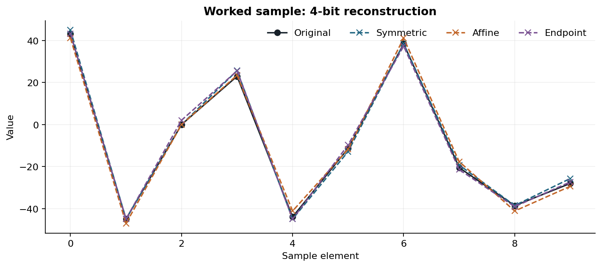
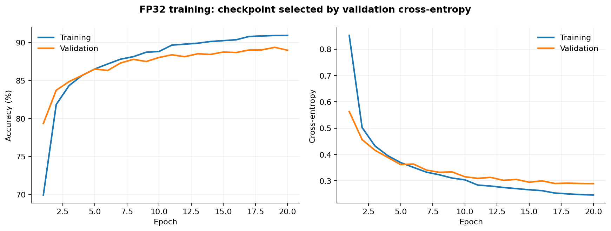
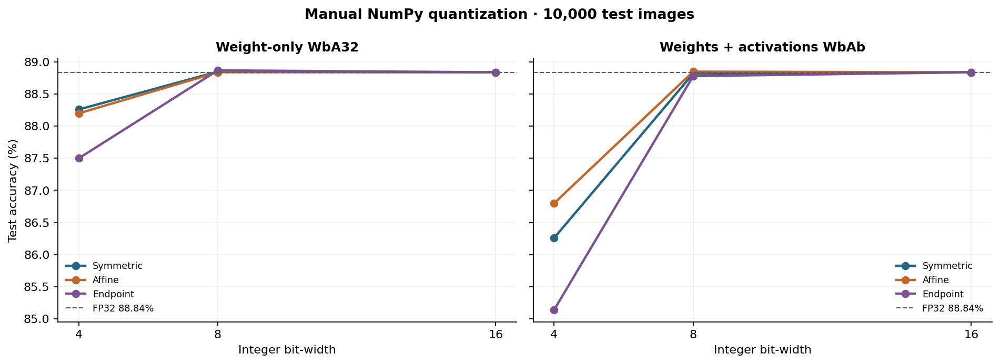
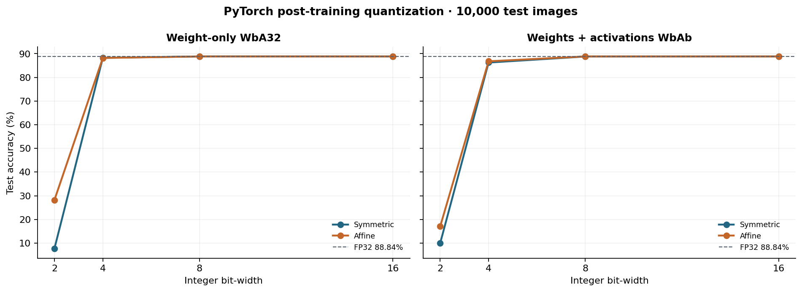
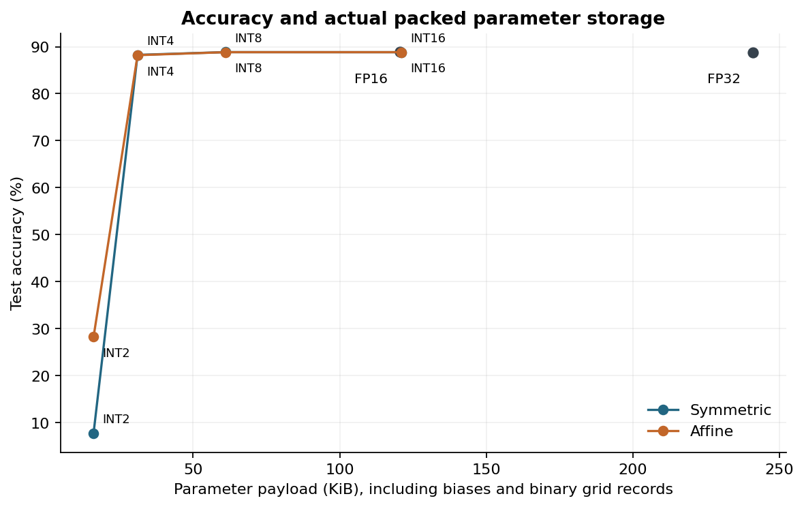
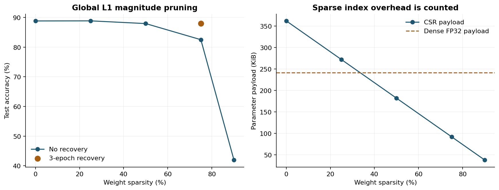
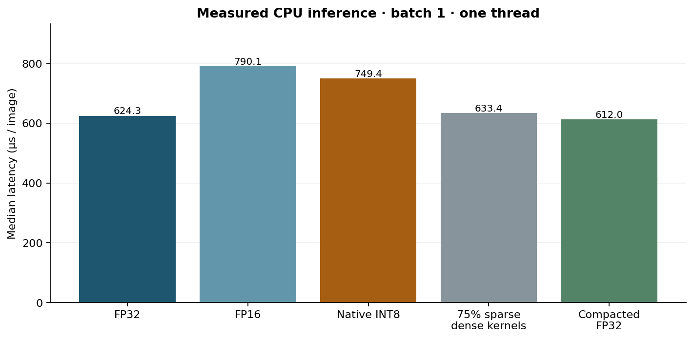

# Complete Answers: LeNet Quantization and Pruning

**Matin Firoozbakht** | [@matinfirooz](https://github.com/matinfirooz)

## 1. Purpose and memory calculation

Quantization represents continuous parameters and activations using a finite grid. The main direct benefit in this project is a smaller parameter payload. Native integer kernels can also change execution cost, while Q/DQ simulation measures numerical effects with floating-point operators. Pruning removes selected connections or channels; a suitable sparse format or actual shape reduction is needed to turn zeros into storage or compute reductions.

For 175 billion parameters at 32 bits:

$$M = 175\times10^9\times32/8 = 700\times10^9\ \text{bytes}.$$

This is **700 GB decimal**, approximately **651.93 GiB**, before activation buffers, optimizer state and runtime metadata. Ideal FP16 and INT8 parameter-only storage would be 350 GB and 175 GB, respectively. Scales, zero-points and bias policies add overhead.

## 2. Manual symmetric quantization

For b bits, the assignment uses a narrow signed range:

$$Q=2^{b-1}-1,\quad q_{\min}=-Q,\quad q_{\max}=Q,$$
$$s=\max_i |x_i|/Q,\quad z=0,$$
$$q=\mathrm{clip}(\mathrm{round}(x/s),-Q,Q),\quad \hat{x}=sq.$$

All-zero tensors use scale 1 and code 0. This implementation uses nearest-even rounding and saturates explicitly. In the absence of clipping, nearest-neighbor reconstruction error is at most half a scale step. The often-used estimate MSE ≈ s²/12 additionally assumes a roughly uniform quantization residual; it is not a guarantee for these weights.

At two bits the narrow symmetric range is **−1 to +1**, so it has three active levels. A two-bit container has four bit patterns; the −2 code is unused. This distinction matters when interpreting the very poor two-bit results.

## 3. Two asymmetric formulations

### 3.1 Literal shifted endpoint formula

The supplied PDF states:

$$s=(x_{\max}-x_{\min})/(2^b-1),$$
$$q=\mathrm{clip}(\mathrm{round}((x-x_{\min})/s),0,2^b-1),$$
$$\hat{x}=sq+x_{\min}.$$

This uses a real-valued offset. It preserves the two endpoints but generally cannot make a floating-point zero exactly representable with an integer zero-point. Constant tensors use scale 1, code 0 and their constant value as the offset.

### 3.2 Hardware affine grid with an integer zero-point

Use a range that includes zero:

$$l=\min(x_{\min},0),\quad h=\max(x_{\max},0),$$
$$s=(h-l)/(2^b-1),\quad z=\mathrm{clip}(\mathrm{round}(-l/s),0,2^b-1),$$
$$q=\mathrm{clip}(\mathrm{round}(x/s)+z,0,2^b-1),\quad \hat{x}=s(q-z).$$

All-zero tensors use s=1 and z=0. Positive and negative constant tensors are handled by including zero in the calibration range. In this formulation code z reconstructs exactly to zero, which is useful for padding, sparse zeros and integer MAC correction. Symmetric and affine methods are compared under the same per-tensor policy; the native backend is a separate per-channel experiment.

### 3.3 Corrected worked example

Input:

```text
[43.21, -44.93, 0, 22.99, -43.93, -11.35, 38.48, -20.49, -38.61, -28.02]
```

Eight-bit symmetric scale: 44.93/127 = 0.3537795275590551.

```text
[122, -127, 0, 65, -124, -32, 109, -58, -109, -79]
```

Eight-bit asymmetric scale: 88.14/255 = 0.3456470588235294. Both asymmetric methods give the following integer codes for this sample:

```text
[255, 0, 130, 197, 3, 97, 241, 71, 18, 49]
```

The supplied 196 is incorrect: (22.99 + 44.93)/s rounds to **197**. In the endpoint grid, code 130 reconstructs to **0.00411764705882689**, while in the affine grid it reconstructs to **0**. Matching codes on this example do not make the two reconstruction formulas equivalent. The implementation keeps full precision when computing scales rather than rounding a printed scale.

| Method | Bits | Scale | Zero-point | MSE | Max absolute error |
| --- | --- | --- | --- | --- | --- |
| symmetric | 16 | 0.001371196631 | 0 | 1.3040512e-07 | 0.00060548723 |
| symmetric | 8 | 0.3537795276 | 0 | 0.0022009412 | 0.081968504 |
| symmetric | 4 | 6.418571429 | 0 | 2.0411924 | 2.6842857 |
| endpoint | 16 | 0.00134493019 | 33407 | 6.3696173e-08 | 0.00062806134 |
| endpoint | 8 | 0.3456470588 | 130 | 0.0066325689 | 0.17247059 |
| endpoint | 4 | 5.876 | 8 | 1.7747596 | 2.592 |
| affine | 16 | 0.00134493019 | 33407 | 5.6747531e-08 | 0.00054520485 |
| affine | 8 | 0.3456470588 | 130 | 0.006582382 | 0.16835294 |
| affine | 4 | 5.876 | 8 | 4.0325004 | 2.862 |



## 4. Data and FP32 model training

Official Fashion-MNIST training data are split class-wise using seed 42: 54,000 train and 6,000 validation. The official 10,000-image test set remains separate. Exactly 1,000 calibration indices are sampled from the training indices using seed 101 and saved. No test labels select checkpoints, ranges, pruning rates or bit-widths.

Images are divided by 255 and zero-padded from 28×28 to 32×32. The concrete LeNet variant is defined below. C3 is fully connected across its input channels, pooling has no trainable parameters, and tanh follows both convolutions and pooling. It is a clearly specified dense LeNet variant rather than a claim to reproduce the original sparse C3 and trainable-subsampling network exactly.

| Layer | Output shape | Parameters | Dense MACs |
| --- | --- | --- | --- |
| Input | 1 × 32 × 32 | 0 | 0 |
| C1: Conv 5×5 + tanh | 6 × 28 × 28 | 156 | 117600 |
| S2: AvgPool 2×2 + tanh | 6 × 14 × 14 | 0 | 0 |
| C3: Conv 5×5 + tanh | 16 × 10 × 10 | 2416 | 240000 |
| S4: AvgPool 2×2 + tanh | 16 × 5 × 5 | 0 | 0 |
| C5: Conv 5×5 + tanh | 120 × 1 × 1 | 48120 | 48000 |
| F6: Linear + tanh | 84 | 10164 | 10080 |
| F7: Linear logits | 10 | 850 | 840 |
| Total | — | 61706 | 416520 |

For each convolution, the dense MAC count is Hout × Wout × Cout × Cin × Kh × Kw. Each linear layer uses Cin × Cout MACs. Bias additions, tanh, pooling and softmax are outside this MAC count. F7 returns raw logits for cross-entropy training. Softmax is only a presentation of class probabilities; it is not applied before the training loss. Prediction uses the largest logit, with the first class index selected on a tie.

AdamW uses batch size 256, learning rate 0.001, weight decay 0.0001 and learning-rate drops by 0.5 at epochs 10 and 16. Initialization seed is 7; shuffle seed is 42. All 20 epochs are completed and minimum validation cross-entropy selects epoch 20. The official-test result is **88.84%**. CPU execution uses 4 threads for training. Exact seeds, timing, versions, history, split indices and source hashes are saved.



## 5. Step 1: NumPy-only model evaluation

`software/quantization.py` implements the numerical grids without importing a neural-network framework. `software/numpy_lenet.py` implements im2col convolution, matrix multiplication, tanh, average pooling and stable cross-entropy using NumPy. `scripts/run_manual.py` is run in an isolated process and records that no PyTorch, TensorFlow, JAX or Keras module was imported.

For weight-only evaluation, all five weight tensors are quantized per tensor, then reconstructed, while biases and activations stay FP32. The WbAb extension also quantizes eight activation points using fixed training-calibration extrema: input, C1 tanh, S2 tanh, C3 tanh, S4 tanh, C5 tanh, F6 tanh and logits. Arithmetic and nonlinear functions are FP32 in both modes.

The NumPy FP32 implementation agrees with every one of the 10,000 PyTorch baseline predictions. Maximum logit discrepancy is 6.6757202e-06, consistent with different floating-point reduction orders. These are numerical equivalence results, not integer-kernel timing results.

| Bits | Method | WbA32 correct / 10,000 | WbA32 accuracy (%) | WbAb accuracy (%) |
| --- | --- | --- | --- | --- |
| 16 | symmetric | 8884 | 88.84 | 88.84 |
| 16 | affine | 8884 | 88.84 | 88.84 |
| 16 | endpoint | 8884 | 88.84 | 88.84 |
| 8 | symmetric | 8885 | 88.85 | 88.82 |
| 8 | affine | 8884 | 88.84 | 88.85 |
| 8 | endpoint | 8887 | 88.87 | 88.78 |
| 4 | symmetric | 8826 | 88.26 | 86.26 |
| 4 | affine | 8820 | 88.20 | 86.80 |
| 4 | endpoint | 8750 | 87.50 | 85.14 |



## 6. Step 2: PyTorch PTQ and precision coverage

Train FP32 once, then quantize without changing its learned parameters through optimization. The assignment defines PTQ as post-training conversion; its later wording about training at each precision is interpreted as preparing and evaluating each quantized model from the trained baseline. Quantization-aware training is a different method and is not silently substituted for PTQ. The pruning recovery experiments are explicitly separate.

FP16 evaluates an actual half-precision model and half-precision inputs on the CPU. For INT16/8/4/2, PyTorch 2.5.1 `FakeQuantize` and `MinMaxObserver` compute per-tensor grid parameters. Custom ranges are carried by qint8/quint8 for up to eight logical bits and qint32 for the 16-bit grid. The storage carrier does not imply an INT16 convolution kernel. Weight observers see the trained weights. Activation observers see frozen FP32 extrema measured on the 1,000 training calibration images; observers are disabled for evaluation.

Weights are reconstructed on the selected grid and retained in a saved FP32 Q/DQ state dictionary. Activation quantization uses `torch.fake_quantize_per_tensor_affine`. Codes for export are recovered from the actual PyTorch fake-quantized output, then reconstructed and compared exactly. This avoids assuming that float32 reciprocal multiplication at rounding boundaries is always identical to NumPy float64 division.

| Precision | Method | WbA32 correct | WbA32 accuracy (%) | WbAb accuracy (%) | WbA32 payload (bytes) | Compression |
| --- | --- | --- | --- | --- | --- | --- |
| FP32 | floating point | 8884 | 88.84 | — | 246824 | 1.00× |
| FP16 | floating point | 8885 | 88.85 | — | 123412 | 2.00× |
| INT16 | symmetric | 8884 | 88.84 | 88.84 | 123984 | 1.99× |
| INT16 | affine | 8884 | 88.84 | 88.84 | 123984 | 1.99× |
| INT8 | symmetric | 8885 | 88.85 | 88.82 | 62514 | 3.95× |
| INT8 | affine | 8884 | 88.84 | 88.85 | 62514 | 3.95× |
| INT4 | symmetric | 8826 | 88.26 | 86.26 | 31779 | 7.77× |
| INT4 | affine | 8820 | 88.20 | 86.80 | 31779 | 7.77× |
| INT2 | symmetric | 771 | 7.71 | 10.00 | 16412 | 15.04× |
| INT2 | affine | 2822 | 28.22 | 17.08 | 16412 | 15.04× |

A real converted INT8 model uses QuantStub/DeQuantStub, min–max activation observers with 0..255 codes, per-output-channel symmetric weight observers and the x86 quantized engine. All three Conv2d and both Linear modules are verified as quantized operators. It scores **88.29%** (8829/10,000). Tanh and pooling follow the quantized backend rules. Its grids differ from the controlled per-tensor Q/DQ experiment, so its accuracy difference is not a pure test of integer arithmetic alone. Native INT16, INT4 and INT2 speedups are not asserted.



## 7. Answers to the analysis questions

**How does quantization affect accuracy?** FP32 scores 88.84% and FP16 88.85%. At sixteen bits, symmetric and affine weight-only accuracy are 88.84% and 88.84%. At eight bits they are 88.85% and 88.84%, with W8A8 at 88.82% and 88.85%. At two bits, the weight-only results are 7.71% symmetric and 28.22% affine. Small differences on a single test set do not establish a repeatable accuracy improvement.

**What is the compression/accuracy trade-off?** FP32 parameter storage is 246,824 bytes. Packed weight-only payloads at INT16/8/4/2 are 123,984, 62,514, 31,779, 16,412 bytes. Their compression ratios are 1.99×, 3.95×, 7.77×, 15.04×, including biases and weight grid records. Four-bit symmetric weight-only inference scores 88.26% with 7.77× compression. WbAb additionally stores activation grid records; its complete byte counts are included in the result files. JSON, serialization overhead and activation working buffers are separate quantities.

**Which method works better?** Compare each policy separately. At four bits, symmetric weight-only accuracy is 88.26% and affine is 88.20%. W4A4 scores 86.26% symmetric and 86.80% affine. The literal endpoint grid scores 87.50% weight-only and 85.14% W4A4. Outliers, per-tensor range selection and activation rounding affect these outcomes. The native per-channel configuration is reported independently.

**At what bit-width does accuracy significantly degrade?** Use a descriptive threshold of a one-percentage-point loss from FP32. At four bits, symmetric and affine weight-only losses are 0.58 and 0.64 points. The corresponding W4A4 losses are 2.58 and 2.04 points. The first width crossing this threshold when stepping through 16, 8, 4 and 2 bits is: symmetric weights_only: 2; symmetric weights_activations: 4; affine weights_only: 2; affine weights_activations: 4. This is an explanatory convention, not a hypothesis test or a bit-width selected to optimize test accuracy.

**Can reduced memory be claimed as a speedup?** Q/DQ uses FP32 operators. Native low-precision kernels and sparse formats also have dispatch, packing and indexing costs. The separate CPU measurements describe the tested host and shapes; parameter compression alone is not a latency measurement.




## 8. Pruning extension

The source title and introduction mention pruning but prescribe no pruning algorithm or rates. This additional study fixes global L1 weight sparsities of 0%, 25%, 50%, 75% and 90%, preserving biases. PyTorch masks remain attached during recovery, so masked connections cannot regrow. Mask removal occurs only after recovery when producing a normal state dictionary. Due to rounding of the requested number of weights, 25% means 15,368 of 61,470 weights and 75% means 46,102 weights; exact measured sparsities are saved.

| Pruning | Correct / 10,000 | Accuracy (%) | CSR payload (bytes) | Dense MACs / image |
| --- | --- | --- | --- | --- |
| 0% global L1 | 8884 | 88.84 | 370728 | 416520 |
| 25% global L1 | 8887 | 88.87 | 278520 | 416520 |
| 50% global L1 | 8795 | 87.95 | 186318 | 416520 |
| 75% global L1 | 8252 | 82.52 | 94116 | 416520 |
| 90% global L1 | 4195 | 41.95 | 38790 | 416520 |
| 75% + 3 recovery epochs | 8799 | 87.99 | 94116 | 416520 |
| Compacted + 3 recovery epochs | 8787 | 87.87 | 139,116 dense FP32 | 231700 |

The recovered 75% sparse model reaches 87.99%; the joint recovered-sparse plus weight-only symmetric INT8 model reaches 88.01%. Recovery uses three AdamW epochs at learning rate 0.0001 with fixed seed 17 and validation cross-entropy checkpoint selection.

A second experiment physically compacts channels from 6/16/120/84 to 4/12/90/63. L1 output-row scores select channels from the trained dense weights, and the kept indices are propagated through subsequent inputs, including both dense layers. Before recovery the compact model is 73.30%; after three recovery epochs it is 87.87%. The compact tensors have 34,779 parameters and 231,700 dense MACs per image, reductions of 43.64% and 44.37%. Before recovery its outputs match a corresponding masked full-sized network within 1.4305115e-06 maximum logit error.

Sparse export uses FP32 values (4 bytes), uint16 column indices (2 bytes), uint32 row pointers and FP32 biases. For the full network there are 236 output rows across the five learned layers and five extra terminal row-pointer entries, hence 964 row-pointer bytes. Total CSR payload is **6 × nnz + 964 + 944 bytes**. Below sufficient sparsity, indices can make storage larger than dense FP32, as the 25% result demonstrates. Zero masks alone retain dense tensor dimensions and dense MAC counts. Channel compaction provides a direct reduction in those dimensions.



## 9. Hardware preparation and numerical contract

Convolutions use OIHW and linear layers OI layout, both flattened in C order. INT2/4/8/16 packing uses the first code in the least significant bits of the byte; signed values are two’s-complement and 16-bit words are little-endian. Each layer starts on a byte boundary. All padding bits are zero. Metadata gives shapes, counts, byte offsets, scales, zero-points and SHA-256.

For integer affine operands, the exact widened accumulation is:

$$A_j=\sum_{i=0}^{K-1}(q_{x,i}-z_x)(q_{w,ji}-z_w)+b_{q,j},$$
$$b_{q,j}=\mathrm{round}(b_j/(s_xs_w)),\qquad \hat{y}_j=s_xs_w A_j.$$

Equivalent correction before adding bias is:

$$\sum_i q_{x,i}q_{w,ji}-z_w\sum_i q_{x,i}-z_x\sum_i q_{w,ji}+Kz_xz_w.$$

The exporter supplies optional INT64 bias codes, per-layer conservative accumulator bounds, required signed widths and an exact central C1 patch golden vector. The first image's padded input patch at row/column 12 is used, providing nontrivial pixel values. W16 products/accumulations can exceed 32 bits, so the reference widens before subtraction and multiplication. Zero-point subtraction can require b+1 signed bits for an unsigned b-bit code.

The evaluated Q/DQ paths retain FP32 biases; the rounded integer bias references are not substituted into those evaluations. A complete integer-only accelerator would additionally need a defined tanh approximation, average-pooling rounding, requantization policy, buffering, interface protocols and cycle-level verification. The supplied hardware diagrams are authored mapping references, and no complete RTL, synthesis or routed PPA is claimed.

`hardware/README.md` specifies each binary file and shows a decoder. Every packed weight export is round-trip checked against the saved evaluated model, and the integer dot-product identity is tested independently. Native per-channel INT8 exports retain their own scales and zero-points rather than reusing the per-tensor grid metadata.


### 9.1 Executable packed-weight runtime

`software/packed_runtime.py` and `scripts/infer_packed.py` load the binary weight/bias/grid files. Weight SHA-256, byte counts, shapes, offsets, grid descriptions, signed ranges and padding bits are checked. Activation grids are read from `activation_qparams.bin` when WbAb is selected. No trained PT/NPZ checkpoint or neural-network framework is needed by this runtime.

```bash
python scripts/infer_packed.py --method affine --bits 8 --index 0
python scripts/infer_packed.py --method symmetric --bits 4 --mode weights_activations --all
```

`python scripts/qualify_packed.py` reproduces all sixteen full-test evaluations below. Differences are counted against the corresponding saved PyTorch model predictions rather than assumed to be zero. Arithmetic after decoding is NumPy FP32 Q/DQ; integer code packing does not turn this execution into native integer convolution.

| Bits | Method | Policy | Accuracy (%) | Prediction differences vs PyTorch |
| --- | --- | --- | --- | --- |
| 16 | symmetric | weights_only | 88.84 | 0 |
| 16 | symmetric | weights_activations | 88.84 | 0 |
| 16 | affine | weights_only | 88.84 | 0 |
| 16 | affine | weights_activations | 88.84 | 0 |
| 8 | symmetric | weights_only | 88.85 | 0 |
| 8 | symmetric | weights_activations | 88.82 | 0 |
| 8 | affine | weights_only | 88.84 | 0 |
| 8 | affine | weights_activations | 88.85 | 0 |
| 4 | symmetric | weights_only | 88.26 | 0 |
| 4 | symmetric | weights_activations | 86.26 | 0 |
| 4 | affine | weights_only | 88.20 | 0 |
| 4 | affine | weights_activations | 86.80 | 0 |
| 2 | symmetric | weights_only | 7.71 | 0 |
| 2 | symmetric | weights_activations | 10.00 | 0 |
| 2 | affine | weights_only | 28.22 | 0 |
| 2 | affine | weights_activations | 17.08 | 0 |

## 10. CPU measurements

| Model | Median (µs/image) | P90 (µs/image) |
| --- | --- | --- |
| FP32 | 624.34 | 680.78 |
| FP16 | 790.06 | 869.14 |
| Native INT8 | 749.44 | 828.41 |
| 75% sparse weights, dense kernels | 633.38 | 693.52 |
| Compacted FP32 | 612.04 | 666.18 |

Host: **AMD EPYC 7763 64-Core Processor**. PyTorch 2.5.1+cpu, x86 quantized engine, 1 thread, batch 1, 100 warmup and 500 timed forwards. Median and P90 include Python dispatch on a shared CPU. These results are specific to this host and do not establish hardware energy, FPGA timing or a stable broad speedup. The lower dense MAC count of the compact model and the smaller packed payload are independent, directly measured structural properties.



## 11. Verification, reproducibility and limitations

26 unit/integration tests cover exact example arrays, nearest-even ties, saturation, degenerate ranges, invalid inputs, zero representation, every code value at each packing width, odd-length packing, endianness, zero-point correction, data checksums and disjoint calibration, parameter/MAC counts, NumPy/PyTorch parity, all sixteen saved Q/DQ model reloads, converted INT8 operators, mask persistence, sparse round trips, channel compaction and full-test prediction counts. Added checks exercise the packed-model CLI, reject damaged binary grids/payloads, detect newly added source files and verify that report text follows changed measurements.

`results/evidence.json` binds computational sources, original compressed data, checkpoints, hardware exports and numeric measurements to SHA-256 digests. `scripts/verify_evidence.py` detects modified/missing inputs and newly added computational files; `--record` records completed experiments and must be used only after rerunning the affected computation. Generated prose and figures are outside this numeric-evidence hash scope. The notebook displays saved results after checking evidence and independently recomputes the FP32 test accuracy; its optional switches repeat full experiments.

Results describe one trained seed and a fixed calibration sample. There are no confidence intervals across independently trained models. Per-tensor min–max PTQ is intentionally simple; QAT, percentile clipping and learned scales are possible follow-up methods, not measured results here. FP32/F16/native INT8 are actual backend executions; other integer precisions describe simulated grids and real packed storage. All sources and checkpoints are included, and no runtime download is needed for evaluation.

## 12. Primary references and supplied materials

1. Supplied [HW4.pdf](docs/HW4.pdf) and [original assignment README](docs/assignment_README.md).
2. Fashion-MNIST authors' [repository, dataset and license](https://github.com/zalandoresearch/fashion-mnist).
3. PyTorch 2.5.1 [FakeQuantize source](https://github.com/pytorch/pytorch/blob/v2.5.1/torch/ao/quantization/fake_quantize.py) and [observer source](https://github.com/pytorch/pytorch/blob/v2.5.1/torch/ao/quantization/observer.py). The pinned runtime is tested directly; current documentation may describe newer APIs.
4. PyTorch [official pruning tutorial](https://docs.pytorch.org/tutorials/intermediate/pruning_tutorial.html).
5. M. Horowitz, “Computing’s energy problem (and what we can do about it),” ISSCC 2014, [DOI:10.1109/ISSCC.2014.6757323](https://doi.org/10.1109/ISSCC.2014.6757323). Historical context, not a PPA measurement of this project.
6. A. Gholami et al., [A Survey of Quantization Methods for Efficient Neural Network Inference](https://arxiv.org/abs/2103.13630), 2021. Background reference from the supplied assignment.
