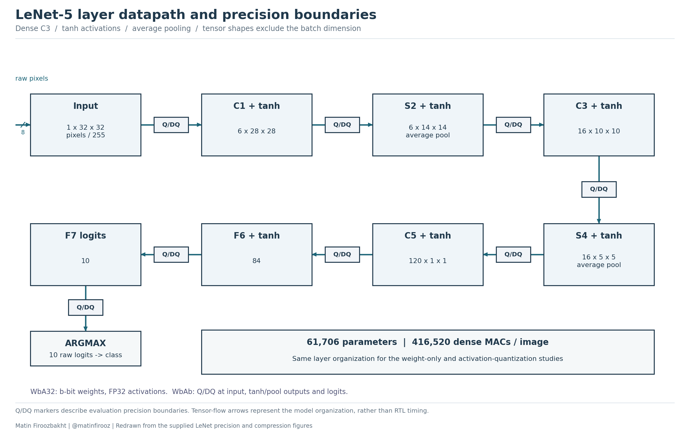
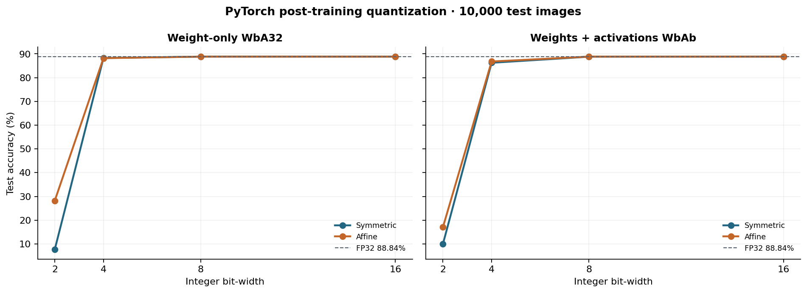
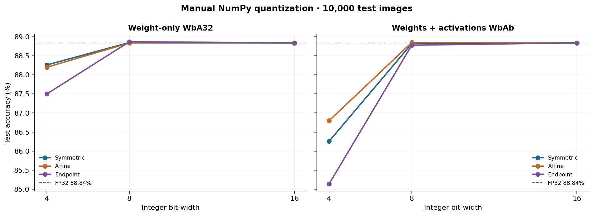
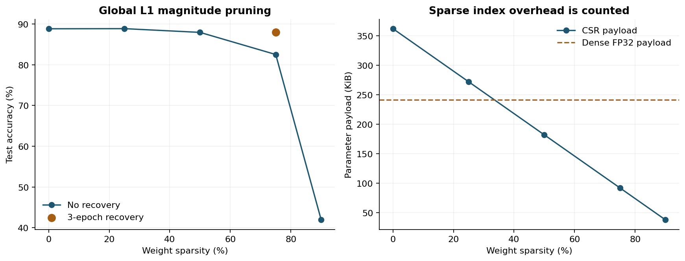
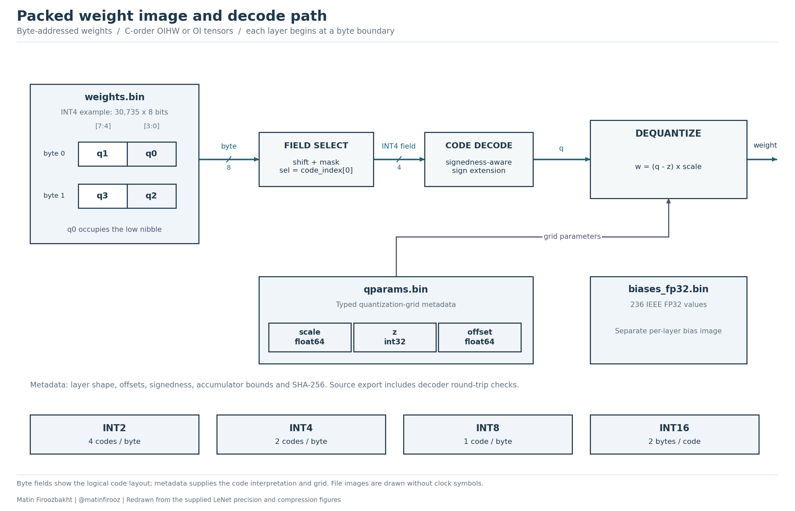

# LeNet Precision Lab: Quantization, Pruning and Hardware Weight Export

**Matin Firoozbakht** | [@matinfirooz](https://github.com/matinfirooz)

A complete Fashion-MNIST study with a trained **61,706-parameter LeNet-5**, manual NumPy quantization, PyTorch post-training quantization, pruning and hardware-ready weight images. Every accuracy uses the **full 10,000-image official test set**. The executed notebook contains the complete answers, source listings, measured tables and figures.



## Included work

- **Manual implementation:** symmetric, integer-zero-point affine and the supplied shifted min–max formula at INT16, INT8 and INT4; complete LeNet inference uses NumPy only.
- **PyTorch implementation:** FP32, true CPU FP16, INT16/INT8/INT4/INT2 grids, frozen PTQ observers and both weight-only and activation quantization studies.
- **Native INT8:** five converted quantized convolution/linear operators, saved checkpoint and separate measured accuracy.
- **Pruning:** five fixed sparsity levels, mask-preserving recovery, CSR exports and actual channel compaction.
- **Hardware exports:** all five learned layers, binary/hex packed codes, biases, scales, zero-points, shapes, offsets and widened integer MAC golden vectors.
- **Verification:** 26 tests, saved full-test predictions, model reload checks, checksummed data and source/result evidence.
- **Figures:** four hardware-style PNG/SVG diagrams and seven measured plot pairs.

## Measured precision results

FP32: **8884/10,000 = 88.84%**. FP16: **8885/10,000 = 88.85%**. Native INT8: **8829/10,000 = 88.29%**.

| Precision | Method | WbA32 correct | WbA32 accuracy (%) | WbAb accuracy (%) | WbA32 payload (bytes) | Compression |
| --- | --- | --- | --- | --- | --- | --- |
| FP32 | floating point | 8884 | 88.84 | — | 246824 | 1.00× |
| FP16 | floating point | 8885 | 88.85 | — | 123412 | 2.00× |
| INT16 | symmetric | 8884 | 88.84 | 88.84 | 123984 | 1.99× |
| INT16 | affine | 8884 | 88.84 | 88.84 | 123984 | 1.99× |
| INT8 | symmetric | 8885 | 88.85 | 88.82 | 62514 | 3.95× |
| INT8 | affine | 8884 | 88.84 | 88.85 | 62514 | 3.95× |
| INT4 | symmetric | 8826 | 88.26 | 86.26 | 31779 | 7.77× |
| INT4 | affine | 8820 | 88.20 | 86.80 | 31779 | 7.77× |
| INT2 | symmetric | 771 | 7.71 | 10.00 | 16412 | 15.04× |
| INT2 | affine | 2822 | 28.22 | 17.08 | 16412 | 15.04× |

**WbA32** quantizes weights to b bits and retains FP32 activations and biases. **WbAb** additionally quantizes the input, tanh/pooling outputs and final logits; its arithmetic and nonlinear functions still execute in FP32. INT16/INT4/INT2 are quantization/dequantization (**Q/DQ**) simulations. The INT8 rows above also use the controlled Q/DQ grid; the native INT8 backend is reported separately because it uses per-channel weight scales and different operator quantization rules. Symmetric INT2 uses **three active values (−1, 0, 1)** in a two-bit container.

Storage is actual packed weight bytes plus retained biases and five 20-byte binary grid records. WbAb also stores eight activation grid records (**160 additional bytes**). JSON descriptions, NPZ/PT serialization, optional integer-bias references and intermediate activation buffers are outside this parameter-payload metric. FP16 stores all parameters as FP16. A Q/DQ checkpoint itself contains floating-point tensors; the packed export provides the compressed representation.



## Complete deliverables

- [Executed Jupyter notebook](HW4_Matin_Firoozbakht.ipynb)
- [Complete written answers](COMPLETE_ANSWERS.md)
- [Manual implementation and results](software/quantization.py)
- [Hardware formats and layer contracts](hardware/README.md)
- [Figure catalog](hardware/FIGURES.md)
- [Requirements and interpretation](docs/SPECIFICATION.md)
- [Measured evidence](results/evidence.json)

## Run the notebook

Python **3.12** is the tested environment. Extract the complete ZIP and run these commands from its project directory:

```bash
python -m venv .venv
# Linux/macOS
source .venv/bin/activate
# Windows PowerShell: .venv\Scripts\Activate.ps1
python -m pip install torch==2.5.1 --index-url https://download.pytorch.org/whl/cpu
python -m pip install -r requirements.txt
jupyter lab HW4_Matin_Firoozbakht.ipynb
```

Choose **Restart Kernel and Run All Cells**. The default notebook verifies saved evidence, recomputes FP32 evaluation, runs the worked example, reloads exported weights and displays all recorded experiments. Saved outputs are already embedded for reading without execution. Keep the notebook inside the extracted project when running it. The dataset and checkpoints are included; evaluation needs no data download.

Set `RECOMPUTE_EXPERIMENTS=True` to repeat the quantization/pruning study. Set `RETRAIN=True` as well to train FP32 again. These switches run the complete ordered reproduction before rebuilding the evidence. Training is deliberately separate from PTQ.

## Reproduce each stage

```bash
python scripts/train.py
python scripts/run_manual.py
python scripts/run_pytorch.py
python scripts/run_pruning.py
python scripts/benchmark.py
python scripts/qualify_packed.py
python -m unittest discover -s tests -v
python scripts/render_figures.py
python scripts/verify_evidence.py --record
python scripts/write_documentation.py
python scripts/build_notebook.py
python scripts/execute_notebook.py
```

For the complete ordered workflow, use `python scripts/run_all.py --train`. To repeat experiments using the saved FP32 model, use `python scripts/run_all.py`.

The manual stage can run in a NumPy-only environment using `requirements-manual.txt`; it loads the supplied trained NPZ and imports no neural-network package. PyTorch is used for training and Step 2.

## Data, training and calibration

Fashion-MNIST supplies 60,000 official training and 10,000 official test images. The deterministic class-wise split reserves **54,000 training / 6,000 validation** images. Calibration uses **1,000 training images**, seed 101, with no validation/test examples. All images are normalized by 255 and padded with a two-pixel zero border to 32×32.

The network uses dense C3 connectivity, tanh activations, average pooling and ten raw output logits. The selected checkpoint is epoch **20** of **20**, chosen by validation cross-entropy. Training uses AdamW, batch 256, initial learning rate 0.001 and a fixed schedule. PTQ performs no parameter retraining. The separate pruning recovery experiments use three epochs and validation-only checkpoint selection. Test labels are used only for reported evaluation.

## Manual quantization results

| Bits | Method | WbA32 correct / 10,000 | WbA32 accuracy (%) | WbAb accuracy (%) |
| --- | --- | --- | --- | --- |
| 16 | symmetric | 8884 | 88.84 | 88.84 |
| 16 | affine | 8884 | 88.84 | 88.84 |
| 16 | endpoint | 8884 | 88.84 | 88.84 |
| 8 | symmetric | 8885 | 88.85 | 88.82 |
| 8 | affine | 8884 | 88.84 | 88.85 |
| 8 | endpoint | 8887 | 88.87 | 88.78 |
| 4 | symmetric | 8826 | 88.26 | 86.26 |
| 4 | affine | 8820 | 88.20 | 86.80 |
| 4 | endpoint | 8750 | 87.50 | 85.14 |

The supplied asymmetric example contains an arithmetic error: **22.99 maps to 197**, using the full-precision scale 88.14/255. The shifted-endpoint formula reconstructs code 130 as approximately **0.00411765**; an integer-zero-point affine grid reconstructs that code as exactly zero. Both formulations are implemented and distinguished throughout the notebook.



## Pruning and compaction

| Pruning | Correct / 10,000 | Accuracy (%) | CSR payload (bytes) | Dense MACs / image |
| --- | --- | --- | --- | --- |
| 0% global L1 | 8884 | 88.84 | 370728 | 416520 |
| 25% global L1 | 8887 | 88.87 | 278520 | 416520 |
| 50% global L1 | 8795 | 87.95 | 186318 | 416520 |
| 75% global L1 | 8252 | 82.52 | 94116 | 416520 |
| 90% global L1 | 4195 | 41.95 | 38790 | 416520 |
| 75% + 3 recovery epochs | 8799 | 87.99 | 94116 | 416520 |
| Compacted + 3 recovery epochs | 8787 | 87.87 | 139,116 dense FP32 | 231700 |

Global zero masks retain the original tensor dimensions and dense MAC count. CSR storage includes FP32 values, uint16 columns, uint32 row pointers and FP32 biases. The compact model physically reduces channels to **4 / 12 / 90 / 63**, giving **34,779 parameters** and **231,700 dense MACs/image**. Its accuracy before recovery was 73.30%; after three recovery epochs it is 87.87%. The additional recovered-75%-sparse plus weight-only INT8 experiment scores 88.01%.



## Hardware weight images



`hardware/exports/` contains FP32 and FP16 parameter images; symmetric and affine INT16/8/4/2 codes; native per-channel INT8 weights; and CSR pruning exports. Convolution layout is **OIHW**, linear layout **OI**. Codes are packed in C-order, starting with the least significant bits of the first byte. Signed codes use two’s complement. INT16 and all multi-byte fields are little-endian.

`metadata.json` records exact shapes, offsets, numerical formats and checksums. Every custom-grid export reloads to the evaluated Q/DQ weights exactly. The C1 golden example checks an exact widened integer dot product with explicit zero-point correction. Integer bias references and accumulator bounds support implementation planning. See [hardware/README.md](hardware/README.md) for formulas and decoder examples.

The diagrams describe the model, binary layouts and an arithmetic mapping reference. This project implements the software study and hardware data exports; full-network RTL, synthesis, routed timing and power are not measured deliverables.

## Run inference from the packed weights

```bash
python scripts/infer_packed.py --method affine --bits 8 --index 0
python scripts/infer_packed.py --method symmetric --bits 4 --mode weights_activations --all
python scripts/qualify_packed.py
```

The NumPy runtime reads packed weights, FP32 biases and binary grid records directly; it does not load a PT/NPZ model or import PyTorch. All **16** custom-grid configurations were evaluated on the full test set. Total prediction differences from their saved PyTorch Q/DQ references: **0**. This is a test of the exported parameters and NumPy Q/DQ model; it is not an integer-only accelerator timing result.

## CPU measurements

| Model | Median (µs/image) | P90 (µs/image) |
| --- | --- | --- |
| FP32 | 624.34 | 680.78 |
| FP16 | 790.06 | 869.14 |
| Native INT8 | 749.44 | 828.41 |
| 75% sparse weights, dense kernels | 633.38 | 693.52 |
| Compacted FP32 | 612.04 | 666.18 |

Measured on **AMD EPYC 7763 64-Core Processor**, one CPU thread, batch 1, 100 warmup calls and 500 timed calls per model. Python dispatch is included. These shared-CPU measurements do not establish a general quantization or sparsity speedup. Lower precision reduces the exported parameter payload; latency also depends on backend, shapes and dispatch overhead.

## Files

| Path | Contents |
| --- | --- |
| `software/` | Model, data loader, manual quantization/inference, PyTorch PTQ, pruning, exports, figures and reports |
| `models/` | FP16, custom-grid Q/DQ, native INT8, sparse and compact checkpoints |
| `hardware/exports/` | Hardware-ready binary and hex parameter images with exact metadata |
| `hardware/figures/` | Four architecture/datapath/layout/pruning PNG/SVG pairs |
| `results/quantization/` | 34 quantization runs, 16 packed-model runs, calibration ranges, examples and predictions |
| `results/pruning/` | Pruning, recovery, compact-model measurements and predictions |
| `results/software/` | Training, data splits, calibration indices, FP32 outputs and CPU latency |
| `results/figures/` | Seven measured plot PNG/SVG pairs |
| `scripts/`, `tests/` | Ordered reproduction, notebook execution and 26 tests |
| `data/fashion/`, `docs/` | Checksummed official data, dataset license and supplied requirements |

Dataset licensing is retained in `data/fashion/LICENSE`. Authored source is provided under the [MIT license](LICENSE). Full implementation choices, quantitative answers and primary references are in [COMPLETE_ANSWERS.md](COMPLETE_ANSWERS.md).
