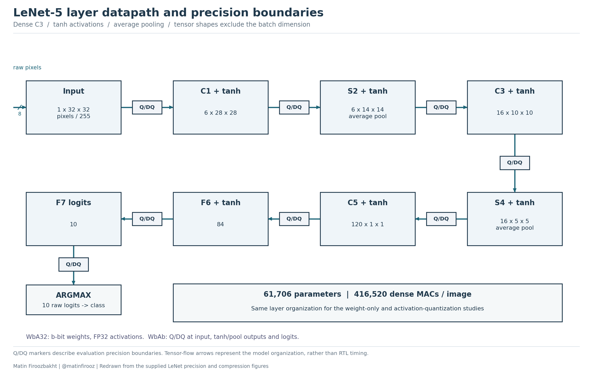
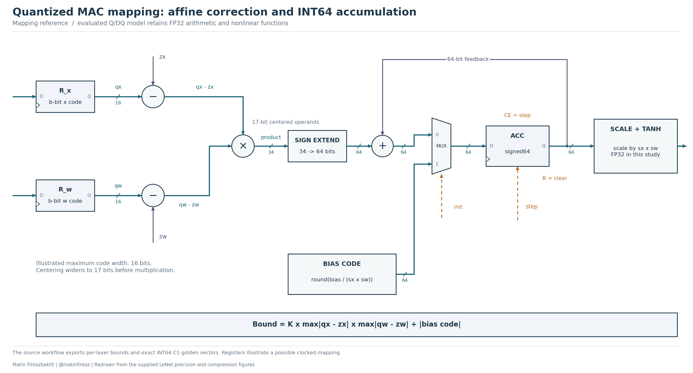
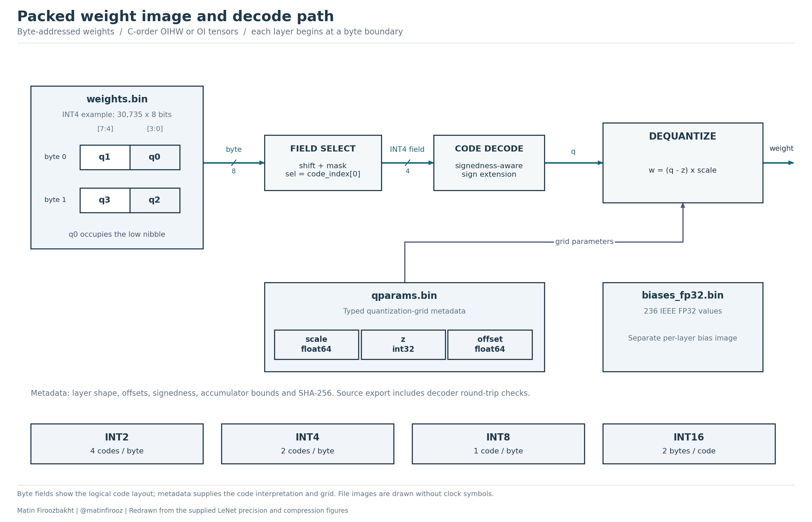
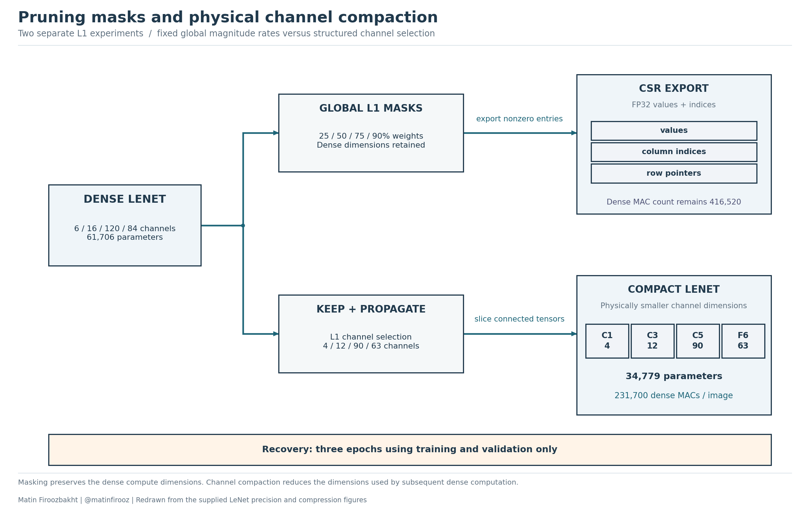

# Hardware and Experiment Figures

**Matin Firoozbakht** · [@matinfirooz](https://github.com/matinfirooz)

## LeNet layers and precision boundaries

[SVG](figures/lenet_architecture.svg) · [PNG](figures/lenet_architecture.png)

## Affine correction, init mux and accumulator feedback

[SVG](figures/quantized_datapath.svg) · [PNG](figures/quantized_datapath.png)

## Packed weight bytes and decoder

[SVG](figures/packed_weights.svg) · [PNG](figures/packed_weights.png)

## Sparse masks and channel compaction

[SVG](figures/pruning_compaction.svg) · [PNG](figures/pruning_compaction.png)

## Measured plots

| Plot | PNG | SVG |
| --- | --- | --- |
| training | [PNG](../results/figures/training.png) | [SVG](../results/figures/training.svg) |
| manual_accuracy | [PNG](../results/figures/manual_accuracy.png) | [SVG](../results/figures/manual_accuracy.svg) |
| pytorch_accuracy | [PNG](../results/figures/pytorch_accuracy.png) | [SVG](../results/figures/pytorch_accuracy.svg) |
| compression_accuracy | [PNG](../results/figures/compression_accuracy.png) | [SVG](../results/figures/compression_accuracy.svg) |
| pruning | [PNG](../results/figures/pruning.png) | [SVG](../results/figures/pruning.svg) |
| worked_example | [PNG](../results/figures/worked_example.png) | [SVG](../results/figures/worked_example.svg) |
| latency | [PNG](../results/figures/latency.png) | [SVG](../results/figures/latency.svg) |
