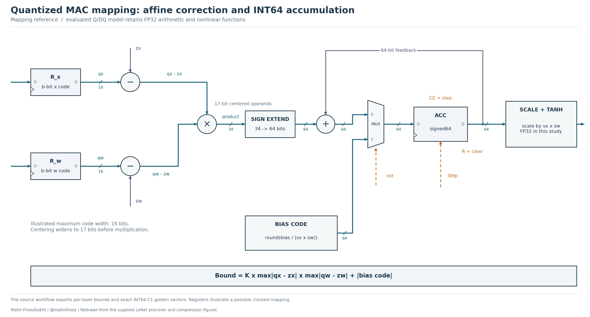

# Hardware Parameter Export Guide

**Matin Firoozbakht** | [@matinfirooz](https://github.com/matinfirooz)

This package prepares exact numerical parameter images for implementing the trained LeNet. It supplies export/decoder software and integer dot-product references. The diagrams illustrate hardware mappings; complete accelerator RTL and physical implementation are outside the measured scope.



## Network and layer shapes

| Layer | Output shape | Parameters | Dense MACs |
| --- | --- | --- | --- |
| Input | 1 × 32 × 32 | 0 | 0 |
| C1: Conv 5×5 + tanh | 6 × 28 × 28 | 156 | 117600 |
| S2: AvgPool 2×2 + tanh | 6 × 14 × 14 | 0 | 0 |
| C3: Conv 5×5 + tanh | 16 × 10 × 10 | 2416 | 240000 |
| S4: AvgPool 2×2 + tanh | 16 × 5 × 5 | 0 | 0 |
| C5: Conv 5×5 + tanh | 120 × 1 × 1 | 48120 | 48000 |
| F6: Linear + tanh | 84 | 10164 | 10080 |
| F7: Linear logits | 10 | 850 | 840 |
| Total | — | 61706 | 416520 |

## Export directories

| Directory | Contents |
| --- | --- |
| `fp32/`, `fp16/` | IEEE parameter images, all weights and biases, exact tensor offsets |
| `symmetric_int{16,8,4,2}/` | Signed narrow symmetric packed codes and scale records |
| `affine_int{16,8,4,2}/` | Unsigned affine packed codes with integer zero-points |
| `native_int8/` | Converted CPU operator weights, per-output-channel scales/zeros and biases |
| `pruned_{0,25,50,75,90}_csr/` | Sparse FP32 values, columns, row pointers and biases |
| `pruned_75_recovered_csr/` | CSR after three mask-preserving recovery epochs |

## Custom-grid files

| File | Exact contract |
| --- | --- |
| `weights.bin` | Packed C-order OIHW/OI weights; each layer starts on a byte boundary |
| `weights.hex` | Same bytes, two hex digits per line, suitable for byte-wide ROM loading |
| `biases_fp32.bin` | Little-endian FP32 biases in layer order |
| `qparams.bin` | Five records: little-endian float64 scale, int32 zero, float64 offset; 20 bytes each |
| `activation_qparams.bin` | Eight 20-byte records in metadata activation-point order |
| `codes.npz` | Named integer arrays for inspection; not a compressed-payload benchmark |
| `{layer}_bias_i64.bin` | Rounded bias/(input_scale × weight_scale), little-endian signed INT64 |
| `conv1_integer_golden.npz` | Central C1 patch codes, weights, rounded bias, exact INT64 accumulators and scaled outputs |
| `metadata.json` | Shapes, counts, offsets, bit ranges, scales, accumulator bounds and weight digest |

Code 0 occupies the least significant bits of byte 0. INT2 packs four codes/byte; INT4 packs two; INT8 packs one; INT16 uses a little-endian two-byte word. Signed codes are two's complement. The unused narrow symmetric minimum (−2 at INT2, −8 at INT4, etc.) is not emitted. Tail padding bits are zero. For example, unsigned INT4 codes [1,2,3] encode as bytes [0x21,0x03].

A symmetric weight reconstructs as q×scale; an affine weight as (q−zero)×scale. The offset field is zero for these Step 2 exports and is reserved for the separate shifted-endpoint formulation. Both retained FP32 bias and optional integer-bias reference are included, with their roles identified rather than combined in reported payload size.

```python
from pathlib import Path
from software.exports import load_export
weights, metadata = load_export(Path('hardware/exports/affine_int8'))
print(weights['conv3.weight'].shape)  # (16, 6, 5, 5)
print(metadata['sha256'])
```

`load_export` verifies the weight digest and payload lengths, reads scales/zero-points from the binary grid records, checks their metadata descriptions, decodes sign and sub-byte packing and reconstructs every tensor. Tests compare these tensors exactly with all evaluated custom-grid checkpoints.

## Execute the exported model

```bash
python scripts/infer_packed.py --method affine --bits 8 --index 0
python scripts/infer_packed.py --method affine --bits 8 --mode weights_activations --all
python scripts/qualify_packed.py
```

The runtime loads the binary parameters and uses the NumPy model. It reports class probabilities for one image or full-test accuracy. Full qualification checks all 16 custom-grid configurations against the saved PyTorch Q/DQ predictions. `results/quantization/packed_results.json` contains actual counts, logit discrepancies and parameter-file hashes. No PT/NPZ checkpoint or PyTorch import is required for packed inference. These are Q/DQ evaluations, not integer-only kernel timings.

## Integer MAC, bias and bounds

Compute `sum((qx-zx)*(qw-zw)) + bias_i64` after widening both code operands before subtraction. Equivalent expansion is `sum(qx*qw) - zw*sum(qx) - zx*sum(qw) + K*zx*zw + bias_i64`. The reference uses INT64 throughout; multiply by input_scale×weight_scale to reconstruct a preactivation. Rounding integer biases introduces a separate error of up to half that product scale; the evaluated Q/DQ models retain FP32 bias.

The conservative absolute bound is K×max|qx−zx|×max|qw−zw| + max|bias_code|. Required signed bits are computed from this bound, with no assumption that an INT32 accumulator is adequate at 16-bit operands. Example, affine W8A8:

| Layer | K | Input scale | Weight scale | Bias scale | Required signed accumulator bits |
| --- | --- | --- | --- | --- | --- |
| conv1 | 25 | 0.0039215689 | 0.0047568283 | 1.865423e-05 | 21 |
| conv3 | 150 | 0.0059640761 | 0.0043652104 | 2.6034447e-05 | 23 |
| conv5 | 400 | 0.0059727714 | 0.0045586494 | 2.7227771e-05 | 24 |
| fc6 | 120 | 0.0078431368 | 0.0043592621 | 3.4190289e-05 | 23 |
| fc7 | 84 | 0.0078431219 | 0.0041601774 | 3.2628779e-05 | 22 |

The golden patch is the first official test image's padded input window [12:17,12:17] for all six C1 filters. The direct centered dot product and expanded zero-point correction must agree exactly. This checks integer arithmetic for a nontrivial local operation; it is not a claim that the full-network Q/DQ results are integer-only accelerator results.

A full deployment must define nonlinear-function accuracy, pooling rounding, requantization multipliers and shifts, saturation, SRAM banking, dataflow, interfaces and clock constraints. The authored datapath shows an init mux loading bias into an accumulator and subsequent multiply-accumulate feedback; it is an arithmetic mapping reference.

## Native INT8 files

The native backend uses separate `{layer}_weight.bin` int8 codes, `{layer}_scale.bin` float64 scales, `{layer}_zero.bin` int32 zero-points and `{layer}_bias.bin` FP32 biases. Scales/zero-points are per output channel (axis 0). `activation_qparams.bin` has six little-endian float64-scale/int32-zero records: input then five learned-layer outputs. Tanh/average-pool quantization follows the pinned PyTorch backend. Its exported metadata must not be replaced with custom per-tensor grid records.

## Sparse weights and compaction

CSR flattens each convolution filter's C,H,W dimension. Each layer stores FP32 values, uint16 columns, uint32 row pointers and FP32 biases, all little-endian. A row contains entries between `rowptr[r]` and `rowptr[r+1]`; missing coordinates are zero. The maximum flattened input width is 400, so uint16 columns are sufficient. Dense execution of the sparse checkpoints still performs all original MACs. The compact checkpoint has genuinely smaller dimensions and 231,700 dense MACs/image.

## Storage accounting

WbA32 = packed weights + 944 FP32 bias bytes + 100 weight-grid bytes. At INT2 the C1 tail byte has four zero padding bits; all other layer payloads are byte-aligned. WbAb adds 160 activation-grid bytes. Optional INT64 bias files, golden vectors, NPZ/PT files and JSON are separately identified auxiliary artifacts. Native INT8 payload counts all exported codes/scales/zero-points/biases plus its 72 activation-grid bytes. Working activation memories, instruction/control state and implementation-specific alignment are outside these parameter-only sizes.

## Figures

See [FIGURES.md](FIGURES.md) for PNG and SVG links. All four diagrams use explicit direction arrows, orthogonal routes, memory/register symbols and typed numerical contracts where appropriate. They are authored illustrations, not Vivado or synthesis screenshots.
